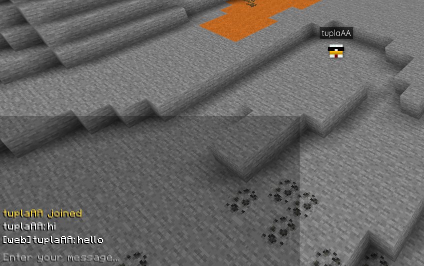
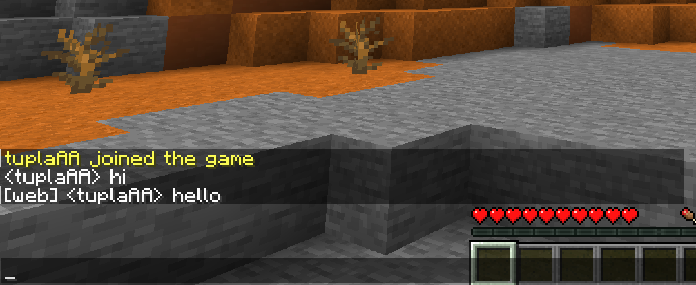

# Auth/BlueMap/Chat

Web chat integration for BlueMap. Requires the BlueMap-Auth integration plugin for extra functionality.

## Images




## Configuration

The `ip` and `port` are the same as with the main projects in this repository. The default port is `8800`.

If `read-auth` is `true`, chat is only visible to logged-in users.  
If `read-only` is `true`, users can not send any messages from web.

`max-message-count` is amount of messages the web app stores in history.  
`web-chat-prefix` is the prefix for messages sent from the web app.

`register-web-app` controls whether this instance injects the chat UI into BlueMap's web app.
Set to `false` on servers that don't host the BlueMap web root.

## Endpoints

*This section is only relevant for advanced usage.*

- `GET /stream` returns an event stream of chat messages as JSON objects that look like the following
```typescript
type Message = {
    uuid: string;
    username: string;
} & ({
    type: "chat" | "webchat" | "death";
    message: string;
} | {
    type: "join" | "leave";
})
```
- `POST /send` is used to send a web chat message. The body should be a JSON object with a `message` field.
Message should be less than 256 characters long.

## Multi-server setup

Run one Chat instance per Minecraft server, each on a different port.

Only one instance should have `register-web-app: true` (the server that hosts the BlueMap web root).
All instances serve their own `/stream` and `/send` endpoints.

Chats will be seperate per server. There is no combining. Chats will work for across maps of dimensions of the same server.

The chat UI automatically connects to the correct server based on the currently viewed map.
Route each map's chat requests to the owning server's Chat instance in Nginx:

```nginx
  # Server B maps, add one block per additional server with its map IDs
  location ~ ^/addons/chat/(server-b-map-1|server-b-map-2)/(.*)$ {
    proxy_pass http://127.0.0.1:8801/$2;
    proxy_buffering off;
  }

  # Server A maps (catch-all)
  location ~ ^/addons/chat/[^/]+/(.*)$ {
    proxy_pass http://127.0.0.1:8800/$1;
    proxy_buffering off;
  }
```

## Nginx configuration

See [the BlueMap Integration example Nginx configuration](https://github.com/Chicken/Auth/tree/master/BlueMap/Integration#example-nginx).
And add the following in your application layer next to the Integration configuration:

```nginx
  location ~ ^/addons/chat/[^/]+/(.*)$ {
    proxy_pass http://127.0.0.1:8800/$1;
    proxy_buffering off;
  }
```
